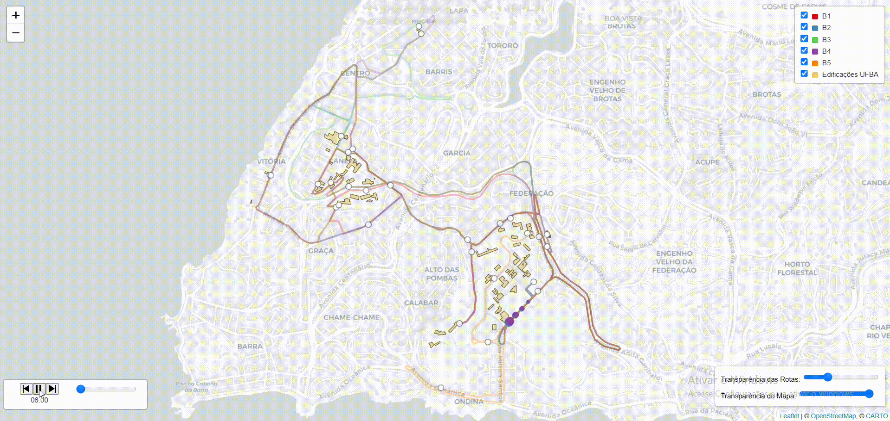

# 🚌 BUZUFBA GTFS e acessibilidade multimodal

Pipeline em R para representar o sistema de ônibus da Universidade Federal da Bahia (BUZUFBA) em formato GTFS e estudar como o transporte coletivo e a caminhada conectam as unidades da UFBA em Salvador. O projeto automatiza a preparação dos horários e itinerários, produz uma animação das viagens e permite comparar cenários de acessibilidade para apoiar análises de mobilidade no campus.

[](#status-do-projeto) [](https://www.r-project.org/) [](https://gtfs.org/) [](LICENSE)

<div align="center">
  <figure>
    
    <figcaption>Operação do Buzufba em um Dia Típico</figcaption>
  </figure>
</div>

## 📑 Índice

- [Status do projeto](#-status-do-projeto)
- [Funcionalidades](#-funcionalidades)
- [Tecnologias](#-tecnologias)
- [Estrutura do repositório](#-estrutura-do-repositório)
- [Pré-requisitos e instalação](#-pré-requisitos-e-instalação)
- [Como usar](#-como-usar)
- [Relatórios](#-relatórios)
- [Licença](#-licença)
- [Contribuição](#-contribuição)

## 🚧 Status do projeto

**Em desenvolvimento.** O repositório contém os fluxos de geração GTFS, animação e comparação de cenários. Os resultados dependem dos dados de entrada e dos serviços locais descritos abaixo.

## ⚙️ Funcionalidades

- Gera um feed GTFS para as linhas B1 a B5, incluindo paradas, viagens, horários, calendário de operação e shapes.
- Usa shapes manuais em GeoPackage quando disponíveis e consulta o Valhalla para calcular tempos entre paradas; sem shapes manuais, também solicita ao Valhalla a geometria das rotas.
- Cria uma [animação HTML interativa](https://gabrielcury30.github.io/buzufba-gtfs/) das viagens do feed, com linha do tempo, paradas, itinerários e edificações da UFBA.
- Compara os cenários atual e de intervenção com o R5: calcula a proporção de outras unidades alcançáveis em até 15 e 30 minutos e tempos totais para fluxos representativos.
- Produz gráficos PNG para os indicadores calculados.
- Mantém relatórios Quarto sobre a geração do GTFS e a análise de acessibilidade.

## 💻 Tecnologias

- **R (4.1 ou superior)** para os scripts e funções do projeto.

- **GTFS** como formato de dados de transporte público.

- **Valhalla** como serviço de roteamento usado na geração do feed.

- **R5 via pacote `r5r`** para matrizes de tempo de viagem e análise multimodal. O `r5r` requer **Java JDK 21**; consulte a [documentação oficial do r5r](https://github.com/ipeaGIT/r5r#installation).

- **Docker** pode ser usado para executar o Valhalla localmente.

- Pacotes R principais: `data.table`, `dplyr`, `ggplot2`, `gtfstools`, `httr2`, `jsonlite`, `purrr`, `sf`, `tibble`, `units`, `r5r`, `geojsonio`, `htmlwidgets`, `leaflet`, `leaftime`, `stinepack` e `tidytransit`.

- **Quarto** é opcional e necessário apenas para renderizar os relatórios `.qmd`.

## 📁 Estrutura do repositório

``` text
.
├── R/                    # Funções de geração, roteamento, animação e análise
├── scripts/              # Pontos de entrada executáveis
├── analysis/             # Relatórios Quarto (.qmd)
├── data/
│   ├── raw/              # Insumos geoespaciais
│   └── processed/        # GTFS, redes R5 e HTML gerados (não versionados)
├── figures/              # Gráficos gerados pela análise (não versionados)
├── LICENSE
└── README.md
```

Principais insumos em `data/raw/`:

- `shapes_rotas_buzufba.gpkg`: geometrias manuais dos itinerários, usadas quando disponíveis.
- `salvador.osm.pbf` e `salvador_mde.tif`: rede viária e elevação usadas na análise R5.
- `edificacoes_ufba.gpkg` e `intervencoes_edificacoes_ufba.gpkg`: edificações/unidades nos cenários atual e de intervenção.

`data/processed/` recebe artefatos regeneráveis; os GTFS, HTML e redes R5 gerados são ignorados pelo Git. A pasta `figures/` também é ignorada. Para informações detalhadas sobre a configuração do Valhalla, consulte [analysis/relatorio_gtfs.qmd](analysis/relatorio_gtfs.qmd).

## 🛠️ Pré-requisitos e instalação 

### Requisitos

- Git e R 4.1 ou superior.
- Java JDK 21 para executar a análise com `r5r`.
- Um serviço Valhalla acessível em `http://localhost:8002` para gerar o GTFS. O relatório [relatorio_gtfs.qmd](analysis/relatorio_gtfs.qmd) descreve como subir o serviço local usando Docker.
- Quarto, somente se for renderizar os relatórios.

### Clonar o projeto

Execute na pasta em que deseja salvar o repositório:

``` sh
git clone https://github.com/gabrielcury30/buzufba-gtfs.git
cd buzufba-gtfs
```

### Instalar os pacotes R

Instale no R os pacotes necessários para os fluxos que pretende executar:

``` r
# Geração do GTFS
install.packages(c(
  "data.table", "dplyr", "gtfstools", "httr2", "jsonlite",
  "purrr", "sf", "tibble", "units"
))

# Animação
install.packages(c(
  "dplyr", "geojsonio", "htmlwidgets", "leaflet", "leaftime",
  "sf", "stinepack", "tidytransit"
))

# Análise de acessibilidade
install.packages(c("dplyr", "ggplot2", "r5r", "sf"))
```

Para instalar o JDK 21 com `rJavaEnv`, uma opção mantida para uso com R:

``` r
install.packages("rJavaEnv")
rJavaEnv::java_quick_install(version = 21)
rJavaEnv::java_check_version_rjava()
```

A geração do GTFS exige que o Valhalla esteja em execução antes de chamar o script. O projeto inclui `data/raw/salvador.osm.pbf`; o relatório Quarto acima traz os passos para iniciar o Valhalla com Docker e preparar esse arquivo.

## ▶️ Como usar

Execute os comandos a partir da raiz do repositório.

### 1. Gerar o feed GTFS

Com o Valhalla respondendo em `http://localhost:8002`:

``` sh
Rscript scripts/gtfs.R
```

O feed será gravado em `data/processed/buzufba_gtfs.zip`. Se `data/raw/shapes_rotas_buzufba.gpkg` existir, o script usa essas geometrias e calcula os tempos com o Valhalla; se não existir, o Valhalla também calcula os shapes.

### 2. Gerar a animação

Depois de gerar o feed, execute:

``` sh
Rscript scripts/buzufba_animation.R
```

O script também requer `data/raw/edificacoes_ufba.gpkg`. O arquivo `data/processed/animacao_buzufba.html` resultante pode ser aberto em um navegador. A visualização inclui controles de tempo e camadas para rotas, paradas e edificações.

### 3. Comparar acessibilidade entre cenários

Prepare estas pastas antes de executar:

- `data/processed/r5r/`: exatamente um arquivo de rede viária `.pbf`, ao menos um feed GTFS `.zip` e, opcionalmente, um arquivo de elevação `.tif`.
- `data/processed/r5r_intervencao/`: a mesma estrutura, com o GTFS do cenário de intervenção.
- Os GeoPackages dos dois cenários ficam em `data/raw/` e são selecionados pelo script.

O repositório fornece a rede e a elevação em `data/raw/`. Depois de gerar o GTFS base e obter um ZIP GTFS com o serviço de intervenção, prepare as pastas (substitua o caminho de exemplo pelo arquivo GTFS de intervenção):

``` powershell
New-Item -ItemType Directory -Force data/processed/r5r, data/processed/r5r_intervencao
Copy-Item data/raw/salvador.osm.pbf, data/raw/salvador_mde.tif data/processed/r5r/
Copy-Item data/raw/salvador.osm.pbf, data/raw/salvador_mde.tif data/processed/r5r_intervencao/
Copy-Item data/processed/buzufba_gtfs.zip data/processed/r5r/
Copy-Item C:/caminho/para/gtfs_intervencao.zip data/processed/r5r_intervencao/
```

O script compara os dados presentes nessas pastas; ele não cria automaticamente o GTFS de intervenção nem executa todos os seis cenários do relatório. Em seguida, execute:

``` sh
Rscript scripts/analise_buzufba.R
```

O script compara o cenário atual com o cenário de intervenção configurado e salva em `figures/`:

- `grafico_acessibilidade_15min.png`
- `grafico_acessibilidade_30min.png`
- `grafico_tempo_total_viagem_fluxos_ufba.png`

As redes R5 são construídas/reutilizadas dentro dessas pastas de cenário. A primeira execução pode levar mais tempo. A data e o horário da partida, os parâmetros de viagem e as unidades representativas podem ser alterados no início de `scripts/analise_buzufba.R`.

## 📊 Relatórios

Os arquivos-fonte Quarto ficam em `analysis/`. Para renderizar o relatório de geração do GTFS:

``` sh
quarto render analysis/relatorio_gtfs.qmd
```

O relatório de análise (`analysis/relatorio_analise.qmd`) documenta o estudo de seis combinações de itinerários e referencia figuras de cenário. Essas figuras precisam estar disponíveis em `figures/` para que o relatório seja renderizado com todos os gráficos.

Os relatórios de análise e construção do GTFS foram publicados e podem ser acessados através dos links:

- [Relatório da construção do GTFS](https://gabrielcury30-relatorio-gtfs.share.connect.posit.cloud/).

- [Relatório da Análise](https://gabrielcury30-relatorio-analise.share.connect.posit.cloud/).

## ⚖️ Licença

O código deste projeto é distribuído sob a licença [MIT](LICENSE). A licença dos dados geográficos pode depender de suas fontes e não deve ser presumida como MIT.

## 🤝 Contribuição

Contribuições são bem-vindas:

1.  Abra uma *issue* para discutir mudanças maiores ou relatar um problema.
2.  Faça um fork e crie uma branch para sua alteração.
3.  Descreva no *pull request* o objetivo da mudança e os arquivos afetados.
4.  Para alterações nos scripts, informe quais entradas e comandos foram usados na verificação; não inclua dados grandes ou artefatos gerados sem necessidade.
